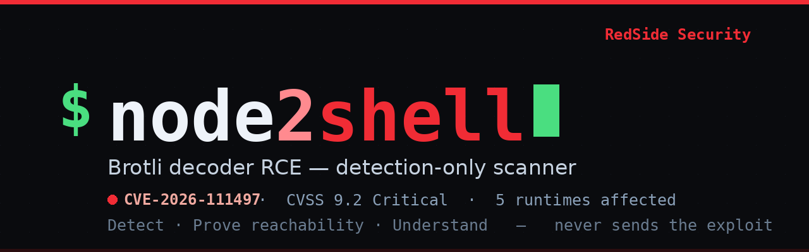

<p align="center">
  
</p>

<p align="center"><strong>Detect · Prove reachability · Understand</strong><br>
CVE-2026-111497 — the Brotli decoder out-of-bounds write in Node.js, Bun, Envoy, .NET and Python.<br>
A single-file detection-only scanner and a realistic lab — by <strong>RedSide Security</strong>.</p>

<p align="center">


</p>

---

## Scan in 10 seconds

No install, no dependencies — just Python 3.8+:

```bash
git clone https://github.com/RedSideSecurity/node2shell
python3 node2shell/scanner/n2s_scan.py -u https://api.example.com/v1/orders --probe
```

```
RedSide Node2Shell scanner v1.0.0  -  CVE-2026-111497 (detection only)

[VULNERABLE] https://api.example.com/v1/orders
    platforms : Node.js 24.22.0 [VULN]
    brotli    : decodes (br=200 unknown=415)
    evidence  : Express via header; Node.js 24.22.0 via /health; probe:decodes (br=200 unknown=415)
```
*(a "Fixed versions:" reference table also prints after the results)*

- `-u URL` one target · `-l file` a list · `--probe` add the behavioral Brotli check · `--json` / `-o out.csv`
- Exit code **2** if anything is `VULNERABLE` or `LIKELY VULNERABLE` — drop it straight into CI.
- **Detection only.** It never sends the malformed stream that triggers the bug.

> Scan only systems you are authorized to test. Full flag reference: **[scanner/README.md](scanner/README.md)**.

---

## What this is

**Node2Shell** (also *HTTP2Shell* / *Broccoli2Shell*, **CVE-2026-111497**) is a critical
out-of-bounds write in Google's Brotli **decoder**, which Node.js, Bun, Envoy, .NET and Python's
Brotli bindings all bundle. A server is exposed when it *decompresses attacker-controlled Brotli
data* — most commonly an HTTP request body sent with `Content-Encoding: br` (Express 5 +
body-parser 2 does this by default). The impact ranges from crash to memory disclosure to remote
code execution.

This repository is a complete, **honest** toolkit for it:

| Component | What it does |
|---|---|
| **`scanner/`** | A single-file, dependency-free Python scanner. Fingerprints the platform/version and, with `--probe`, checks whether the server actually decodes Brotli request bodies. |
| **`lab/`** | A Docker lab: a vulnerable target, a patched control, and a *stealth* vulnerable target with its version hidden — so you can see every verdict tier for real. |

> RedSide also runs a **hosted web checker** (enter a URL, get a verdict) built on this same engine.
> That's a separate service; this repo is the open-source CLI tool and lab.

## Why this one is different

Most public material for this CVE is one of three things, and each is misleading on its own:

- **Weaponized, target-pinned RCE PoCs** that only land against one exact Docker image digest with a
  frozen 23 MB payload — impressive, but they prove nothing about *your* server and are unsafe to run.
- **Crash / DoS PoCs** that just tip a process over.
- **Version-string checkers** that miss every server which hides its version.

**node2shell does none of those.** It is **detection only** — it never sends the malformed stream
that triggers the bug. Instead it answers the two questions that actually matter for triage:

1. **Is an affected runtime present, and is its version behind the fix?** (headers + health endpoints)
2. **Is the vulnerable code path even reachable** — does the server decompress Brotli bodies at all?
   This is a **behavioral** check, so it flags servers that hide their version entirely — the realistic
   case a version checker silently passes.

And the lab proves it honestly: a hidden-version vulnerable target that **only** the behavioral probe
can catch.

## Try it against the lab

### Run the lab and see every verdict tier
```bash
cd lab && ./run.sh
#   VULNERABLE (version visible) : http://127.0.0.1:8091/   node 24.22.0
#   PATCHED    (control)         : http://127.0.0.1:8092/   node 24.22.1
#   STEALTH    (version hidden)  : http://127.0.0.1:8093/   node 24.22.0, behavioral-only

python3 scanner/n2s_scan.py -l <(printf '%s\n' \
  http://127.0.0.1:8091/api/orders \
  http://127.0.0.1:8092/api/orders \
  http://127.0.0.1:8093/api/orders) --probe
```
```
[VULNERABLE] http://127.0.0.1:8091/api/orders
    platforms : Node.js 24.22.0 [VULN]
    brotli    : decodes (br=200 unknown=415)

[PATCHED] http://127.0.0.1:8092/api/orders
    platforms : Node.js 24.22.1 [fixed]
    brotli    : decodes (br=200 unknown=415)

[LIKELY VULNERABLE] http://127.0.0.1:8093/api/orders
    platforms : -
    brotli    : decodes (br=200 unknown=415)
```
The stealth target (8093) hides its version, so only the **behavioral probe** flags it — the case a
version-only checker silently passes.

## Verdicts

| Verdict | Meaning |
|---|---|
| `VULNERABLE` | Affected platform visible, version older than the fix. |
| `LIKELY VULNERABLE` | Server decodes Brotli request bodies (reachable surface) but version is hidden. |
| `POTENTIALLY VULNERABLE` | Affected platform present, version hidden, body probe inconclusive. |
| `PATCHED` | Visible version already includes the fix. |
| `NOT DETECTED` | No affected platform observed from outside. |

> A WAF/CDN that strips `Content-Encoding: br` can mask the probe, so a clean result does not prove
> the runtime behind it is patched. Always confirm against the real runtime version.

## Fixed versions

| Software | First fixed release |
|---|---|
| Node.js | 22.23.4, 24.22.1, 26.12.1 — older lines are EOL (no fix) |
| Bun | 1.4.4 |
| Envoy / Istio | 1.37.8, 1.38.6, 1.39.3, 1.40.0 |
| Python `Brotli` / `brotlicffi` | 1.2.1 / 1.2.1.0 |
| .NET | Microsoft out-of-band update (Oct 2026) |
| Brotli library (`libbrotlidec`) | 1.0.10, 1.1.1, 1.2.1 |

> Version-based verdicts (`VULNERABLE` / `PATCHED`) are computed for Node.js, Bun and Envoy. .NET and
> Python don't expose a reliable Brotli version over HTTP, so they're flagged by **reachability** (the
> behavioral probe) and top out at `POTENTIALLY VULNERABLE` — confirm those against the runtime.

## Responsible use

This is for **lawful, authorized** security testing only — your own systems or targets you have
explicit permission to test. The scanner executes no code on targets and never sends the malformed
stream. The fix is simple: **update the runtime and rebuild your images.**

---

<p align="center">Under active development · feedback: <a href="mailto:info@redsidesecurity.com">info@redsidesecurity.com</a> · <strong>RedSide Security</strong></p>
